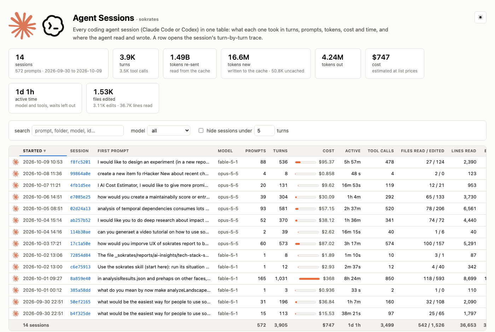

# Claude session tracer

See what a Claude Code or Codex session cost, turn by turn: one column per API call, the tokens it re-sent from the
prompt cache, wrote to it and produced, and the files the agent read, searched and edited in that turn.

**Page:** https://zeljkoobrenovic.github.io/claude-session-tracer/ (example sessions embedded; drop your own trace on it);
the same examples [as a sessions table](https://zeljkoobrenovic.github.io/claude-session-tracer/sessions/).


## How it works

Claude Code writes a transcript of every session, interactive or `claude -p`, under
`~/.claude/projects/<folder slug>/<session id>.jsonl`. Every assistant message in it carries the call's token usage
(`cache_read_input_tokens`, `cache_creation_input_tokens`, `input_tokens`, `output_tokens`), and every tool call is
followed by its result. Nothing has to be logged in advance. `turn_trace.py` reads one transcript into a small JSON
document, and the page renders it.

```bash
python3 turn_trace.py --cwd /path/you/ran/claude/in --list              # the sessions started there: id, start, API calls, prompt
python3 turn_trace.py --cwd /path/you/ran/claude/in --out trace.json    # the latest of them
python3 turn_trace.py --cwd /path/you/ran/claude/in --session f8fc5201 --out trace.json   # a specific one (id prefix)
python3 turn_trace.py --transcript ~/.claude/projects/<slug>/<id>.jsonl --root /path/to/repo --out trace.json
```

Then open the page (or `docs/index.html` locally) and drop `trace.json` on it, or pick it with the file input.
Python 3.8+, no dependencies.

### Live: watch a session as it runs

```bash
python3 serve.py                                   # follows the latest session of the folder you are in
python3 serve.py --cwd /path/you/ran/claude/in     # ... of another folder
python3 serve.py --session f8fc5201 --interval 5   # pins one session; refresh every 5 s (default 3)
```

`serve.py` starts a local server (http://localhost:8765, `--port` to change) and opens the page in live mode
(`--no-browser` not to). The page polls the trace every few seconds and re-renders it in place, keeping the selected
turn and the scroll position; "follow newest turn" scrolls to each new column as it arrives. The trace is re-extracted
only when the transcript file changes, and a new session started in the folder is picked up automatically unless
`--session` pins one. A session dropdown in the page switches to any other session of the folder without restarting. Traces dropped on the live page are kept alongside for comparison. Everything stays on your
machine: the server listens on localhost only.

Options: `--root` shortens file paths relative to a folder (default: the session's working directory); `--source-root`
says where the files are now, for their total line counts (default: `--root`); `--title` names the trace.

### All sessions in one table

```bash
python3 build_sessions.py                                  # the sessions of the folder you are in -> ./sessions/index.html
python3 build_sessions.py --cwd /path/a --cwd /path/b      # those folders
python3 build_sessions.py --all --out ~/claude-sessions    # every folder under ~/.claude/projects
python3 build_sessions.py --all --since 2026-10-01 --min-turns 5   # recent, non-trivial ones only
```

`build_sessions.py` writes a sessions page, `index.html`, with one row per session, Claude Code's and Codex's alike:
when it started, the folder, the first prompt, the agent and model, prompts, turns, cost, active time, tool calls, files read and edited, lines read, edits, the
tokens re-sent from the cache, new and output, and the session's span. Columns sort, the search box and the folder and
agent and model selects filter, the tiles and the footer row sum what is listed, and with several folders a table per folder
follows. Next to it, one trace page per session (`<session id>.html`, the page above with that session embedded and a
link back), which the rows open. Everything is self-contained; the transcripts are read in parallel (`--jobs`), about a
second per 50 MB of transcript. `--trace a.json` adds a trace extracted earlier instead of a transcript. The live
server has the same table at http://localhost:8765/sessions, refreshed every 30 s, whose rows open the session in the
live trace page (`/?session=<id>`).



Claude Code deletes transcripts after its `cleanupPeriodDays` (30 by default), so extract a trace in time or copy the
transcript.

### Codex sessions

Codex CLI (and the VS Code extension) keeps a rollout file per session under
`~/.codex/sessions/<year>/<month>/<day>/rollout-<time>-<id>.jsonl`, with a `token_usage_record` (or `token_count`
event) per API call, the tool calls with their outputs, the commands it ran with their output and exit code, a
unified diff per edited file, the user's messages and timestamps. `codex_trace.py` reads them, old (March 2026) and
new (August 2026 on) layouts alike, into the same turns, so every command above takes them too: `--cwd` lists and
extracts the Codex sessions started in a folder next to the Claude Code ones (`--agent codex` or `claude` keeps one
kind), `--transcript` accepts a rollout file, `build_sessions.py --all` includes every Codex session, and `serve.py`
follows the latest session of a folder whichever agent wrote it.

The OpenAI API reports cached and uncached input instead of cache writes, so for a Codex trace the orange row is
**"New, not from cache"**: the input tokens of the call that were not served from the cache, the context it added,
billed at the input rate (`cache_write` in the trace; `input` is 0), while the blue row is the cached input. Output
includes the reasoning tokens. Reads and searches come from the commands Codex ran, edits from the patches it applied
(`FileChange` items, `patch_apply_end` events or the `apply_patch` call), web searches show as search calls. Prices
for `gpt-5.4`, `gpt-5.5` and `gpt-6-astra` are the published list prices (cached input at 10%); `gpt-5.6-sol` comes
from one secondary source and is marked so in `turn_trace.py`; the write premium GPT-6 Astra charges for explicit
cache writes is not modelled.

## What the page shows

- **Re-sent from cache, new on top.** The context each call read from the prompt cache (blue; its light-blue base is
  the static system prompt and tool definitions that every session shares), with what the call added stacked on top in
  the new-context colors. The breakdown rows split it into the shared prefix and the session's own history.
- **New, written to cache.** What the call appended to the conversation: tool results (orange, estimated at 2.3
  characters per token, the median measured on 286 turns of code-reading sessions), the agent's previous output (green),
  the session setup on the first call (yellow: the dynamic system prompt sections, skill and agent listings, CLAUDE.md,
  the prompt), and the reminders and instructions the CLI injects later (grey). The breakdown rows show each alone.
- **Output.** The call's output tokens.
- **Tool calls.** One chip per call (S search, R read, E edit, B build/test, G git, a tick for the final answer), with
  rows per kind underneath and the lines of output in the totals.
- **Cost.** The run's recorded cost when the trace has one, otherwise an estimate from the model's list prices (cache
  reads, 1-hour cache writes, uncached input, output; Haiku 5.5's long-prompt rate per turn). The price table is
  `PRICES` in `turn_trace.py`, dated, embedded into the pages by the builders and used for `meta.cost_estimate_usd`;
  the turn detail shows each turn's share.
- **Seconds per turn.** The model's time (from the prompt or the previous tool result until the response finished
  streaming) and the time its tools then took, from the transcript's timestamps. Waits between prompts are not counted.
- **Prompts.** Where each message you typed starts (a numbered mark and a column border); the turns up to the next
  mark are the agent's answer to it. Hover the mark for the message. A table under the grid lists every prompt with
  the tokens its turns caused, as a share of the session, with their time and cost.
- **Files.** Sortable (first seen, lines read, edits, hits, size, name) and filterable by path. One row per file: lines read (blue), edits (orange), search output lines naming it (dot or count), its
  length, and the first turn it appeared. Files seen only in search results are hidden by default. A file's length is
  the one the session saw (a `Read` reports the file's total lines, a `Write` its content), else the file counted on
  disk when the trace is made.
- **Files map.** Under the grid, every file of the session as a circle whose area is its length, nested in the
  circles of its folders (a chain of folders with nothing else in them is one circle), with the share of its lines
  the agent read as a blue area inside and the share it edited as an orange one, so a small change to a long file is
  a dot in a large circle and a rewrite fills it. Files of unknown length are dashed and sized by the lines touched.
  Click a folder to zoom into it, its background or the breadcrumb to zoom out, a file to jump to its row; hover
  gives the numbers; the file rows' filter applies. Packed and zoomed by a small routine in the page, no library.

Hover a cell for details, click a turn to list its commands. All three token rows share one scale.

File attribution is heuristic: `Read`, `cat`, `sed -n`, `head` and `tail` of a path count as read lines; `Edit`,
`Write`, `sed -i`, a redirect into a file (`cat > f <<EOF`, `echo >> f`), `tee f` and a script fed through a heredoc
that writes files (`python3 - <<PY` with `open(p, "w")`, in which case every path the script names counts) as edits;
a `grep` output line naming a file as a search hit; a piped `head` is a filter, not a read; heredoc bodies are kept
out of the shell parsing; the shell's working directory is tracked across `cd`; failed commands contribute no file
reads.

## Trace format

```
{
  "title": "...", "model": "claude-sonnet-5-5",
  "meta": {"transcript": "<id>.jsonl", "cwd": "...", "model": "...", "turns": N, "cache_read_tokens": ..., "cache_write_tokens": ...,
           "input_tokens": ..., "output_tokens": ..., "started": "...", "ended": "...", "model_s": ..., "tools_s": ..., "duration_s": ...,
           "cost_estimate_usd": ...},
  "shared_prefix": 10874,        # cache read by the first call: the static prefix shared by every session
  "turns": [ {"n": 1, "input": 2, "cache_read": 10874, "cache_write": 8434, "output": 105,
              "text": "what the agent said (first line)", "result_chars": 3425,
              "prompt": "the user's message this turn starts answering (first line); only on those turns",
              "at": "2026-10-09T19:20:08.629Z", "seconds": {"model": 3.6, "tools": 0.8},
              "new": {"prev_output": 147, "tool_results": 1489, "setup": 0, "other": 0},
              "tools": [ {"tool": "Bash", "kind": "search|read|edit|build|vcs|shell|text", "detail": "the command or path",
                          "lines": 30, "files": [ {"path": "a/b.java", "kind": "read|edit|hit", "lines": 30} ] } ] } ],
  "files": [ {"path": "a/b.java", "lines": 1234, "first": 3, "read": 110, "edits": 2, "edit_lines": 9, "hits": 4} ]
                                   # lines: the file's length as the session saw it, else counted on disk when extracted
}
```

## Examples and page

`examples/*.json` are traces of runs from the
[sokrates-size-experiment](https://github.com/zeljkoobrenovic/sokrates-size-experiment) (does splitting long files
save an agent tokens? below the read budget it does not), Sonnet 5.5 and Haiku 5.5 on the same task against long and
split files. `build_page.py` embeds them into `docs/index.html` from `template.html`; the page loads nothing from the network
(its only companion file is the logo), light and dark, and `serve.py` serves the same template in live mode.
`docs/sessions/` is the sessions table of the same examples (`build_sessions.py --trace examples/*.json --out docs/sessions`),
from `sessions_template.html`.

## License

MIT.
