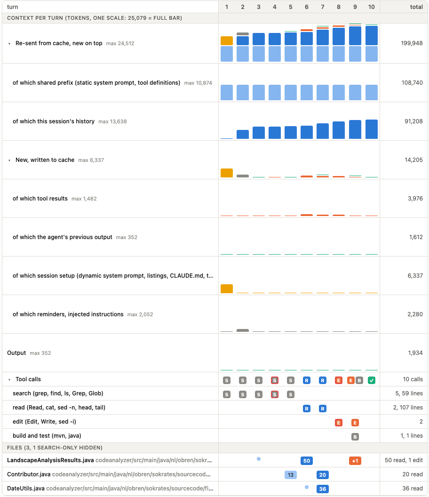

# Claude session tracer

See what a Claude Code session cost, turn by turn: one column per API call, the tokens it re-sent from the prompt
cache, wrote to it and produced, and the files the agent read, searched and edited in that turn.

**Page:** https://zeljkoobrenovic.github.io/claude-session-tracer/ (example sessions embedded; drop your own trace on it)



## How it works

Claude Code writes a transcript of every session, interactive or `claude -p`, under
`~/.claude/projects/<folder slug>/<session id>.jsonl`. Every assistant message in it carries the call's token usage
(`cache_read_input_tokens`, `cache_creation_input_tokens`, `input_tokens`, `output_tokens`), and every tool call is
followed by its result. Nothing has to be logged in advance. `turn_trace.py` reads one transcript into a small JSON
document, and the page renders it.

```bash
python3 turn_trace.py --cwd /path/you/ran/claude/in --list              # the sessions started there: id, start, API calls, prompt
python3 turn_trace.py --cwd /path/you/ran/claude/in --out trace.json    # the latest of them
python3 turn_trace.py --cwd /path/you/ran/claude/in --session f8fc5201 --out trace.json   # a specific one (id prefix)
python3 turn_trace.py --transcript ~/.claude/projects/<slug>/<id>.jsonl --root /path/to/repo --out trace.json
```

Then open the page (or `docs/index.html` locally) and drop `trace.json` on it, or pick it with the file input.
Python 3.8+, no dependencies.

Options: `--root` shortens file paths relative to a folder (default: the session's working directory); `--source-root`
says where the files are now, for their total line counts (default: `--root`); `--title` names the trace.

Claude Code deletes transcripts after its `cleanupPeriodDays` (30 by default), so extract a trace in time or copy the
transcript.

## What the page shows

- **Re-sent from cache, new on top.** The context each call read from the prompt cache (blue; its light-blue base is
  the static system prompt and tool definitions that every session shares), with what the call added stacked on top in
  the new-context colors. The breakdown rows split it into the shared prefix and the session's own history.
- **New, written to cache.** What the call appended to the conversation: tool results (orange, estimated at 2.3
  characters per token, the median measured on 286 turns of code-reading sessions), the agent's previous output (green),
  the session setup on the first call (yellow: the dynamic system prompt sections, skill and agent listings, CLAUDE.md,
  the prompt), and the reminders and instructions the CLI injects later (grey). The breakdown rows show each alone.
- **Output.** The call's output tokens.
- **Tool calls.** One chip per call (S search, R read, E edit, B build/test, G git, a tick for the final answer), with
  rows per kind underneath and the lines of output in the totals.
- **Files.** One row per file: lines read (blue), edits (orange), search output lines naming it (dot or count), its
  total line count, and the first turn it appeared. Files seen only in search results are hidden by default.

Hover a cell for details, click a turn to list its commands. All three token rows share one scale.

File attribution is heuristic: `Read`, `cat`, `sed -n`, `head` and `tail` of a path count as read lines; `Edit`,
`Write` and `sed -i` as edits; a `grep` output line naming a file as a search hit; a piped `head` is a filter, not a read;
the shell's working directory is tracked across `cd`; failed commands contribute no file reads.

## Trace format

```
{
  "title": "...", "model": "claude-sonnet-5-5", "meta": {"turns": N, "cache_read_tokens": ..., ...},
  "shared_prefix": 10874,        # cache read by the first call: the static prefix shared by every session
  "turns": [ {"n": 1, "input": 2, "cache_read": 10874, "cache_write": 8434, "output": 105,
              "text": "what the agent said (first line)", "result_chars": 3425,
              "new": {"prev_output": 147, "tool_results": 1489, "setup": 0, "other": 0},
              "tools": [ {"tool": "Bash", "kind": "search|read|edit|build|vcs|shell|text", "detail": "the command or path",
                          "lines": 30, "files": [ {"path": "a/b.java", "kind": "read|edit|hit", "lines": 30} ] } ] } ],
  "files": [ {"path": "a/b.java", "lines": 1234, "first": 3, "read": 110, "edits": 2, "hits": 4} ]
}
```

## Examples and page

`examples/*.json` are traces of runs from the
[sokrates-size-experiment](https://github.com/zeljkoobrenovic/sokrates-size-experiment) (does splitting long files
save an agent tokens? below the read budget it does not), Sonnet 5.5 and Haiku 5.5 on the same task against long and
split files. `build_page.py` embeds them into `docs/index.html` from `template.html`; the page is a single file with no
external resources, light and dark.

## License

MIT.
